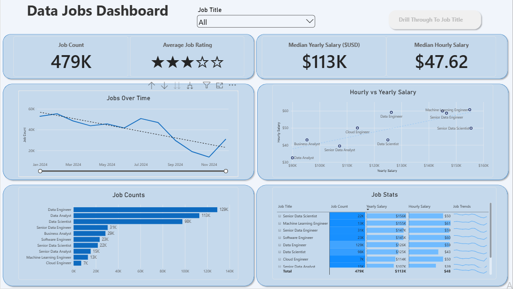

# Data Jobs Dashboard With Power Bi

## Introduction

This dashboard was created for **job seekers, job transitioners, and job swappers** to solve a common problem: information about the data job market is scattered and hard to grasp. Using a real-world dataset of 2024 data science job postings (including titles, salary, and locations), this project provides a single, easy-to-use interface for exploring market trends and compensation.

## Skills Showcased

- **⚙️ Data Transformation (ETL) with Power Query:** Cleaned, shaped, and prepared the raw data for analysis by handling blanks, changing data types, and creating new columns.
- **🧮 Implicit Measures:** Formulated measures to derive key insights and KPIs like `Median Yearly Salary` and `Job Count`.
- **📊 Core Charts:** Utilized **Column, Bar, Line,** and **Area Charts** to compare job counts and track trends over time.
- **🗺️ Geospatial Analysis:** Leveraged **Map Charts** to visualize the global distribution of jobs.
- **📱 KPI Indicators & Tables:** Used **Cards** to display key metrics and **Tables** to provide granular, sortable data.
- **🎨 Dashboard Design:** Designed an intuitive and visually appealing layout, exploring both common and uncommon chart types to best tell the data story.
- - **🎛️ Interactive Reporting:**
  -  **Slicers:** To dynamically filter the report by Job Title.
  -   **Buttons & Bookmarks:** To create a seamless navigation experience.
  -    **Drill-Through:** To navigate from a high-level summary to a contextual, detailed view.
 
## Dashboard Overview

### Page 1: High-Level market View

This is your mission control for the data job market. It showcases KPIs like total job count, median salaries, and top job titles, giving you a quick snapshot of what's happening in the job market.

### Page 2: Job Title Drill Through

